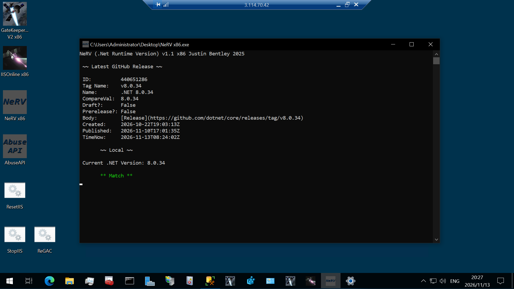
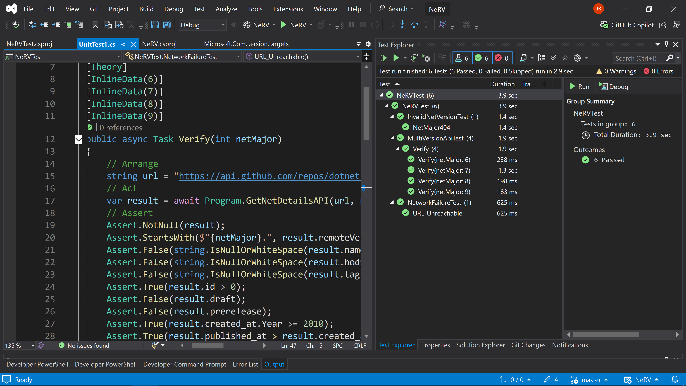

# NeRV
[Windows] Utility to check if System .Net Core Runtimes are up-to-date (C#, .NET, xUnit) 

Running NeRV will tell you if you have the latest .Net runtimes installed. 

NeRV performs this by querying github for the latest Release of .Net Core and comparing that version number to the environment that this program runs in. In releases there are versions that query different editions of .Net Core.

## Notice
If you are using this program to see if there is a new version to manually update, see this video: 
<a href="https://www.youtube.com/watch?v=UcACNMGSByc">
    Youtube - Justin Bentley BSE - Setup Automatic Updates for .Net Core Runtimes on Windows Server
</a>

## Testing with xUnit.

